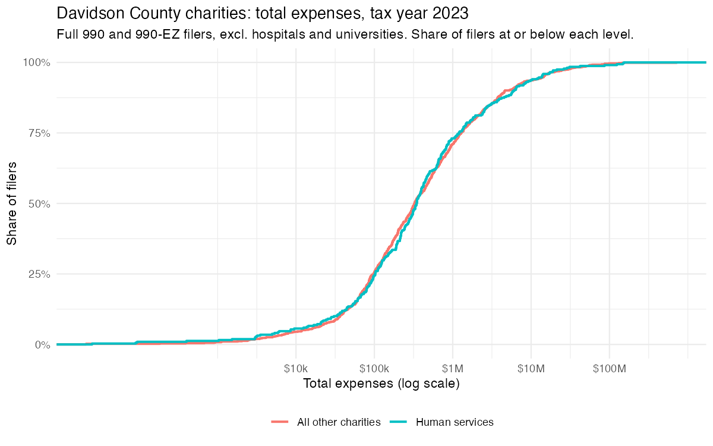
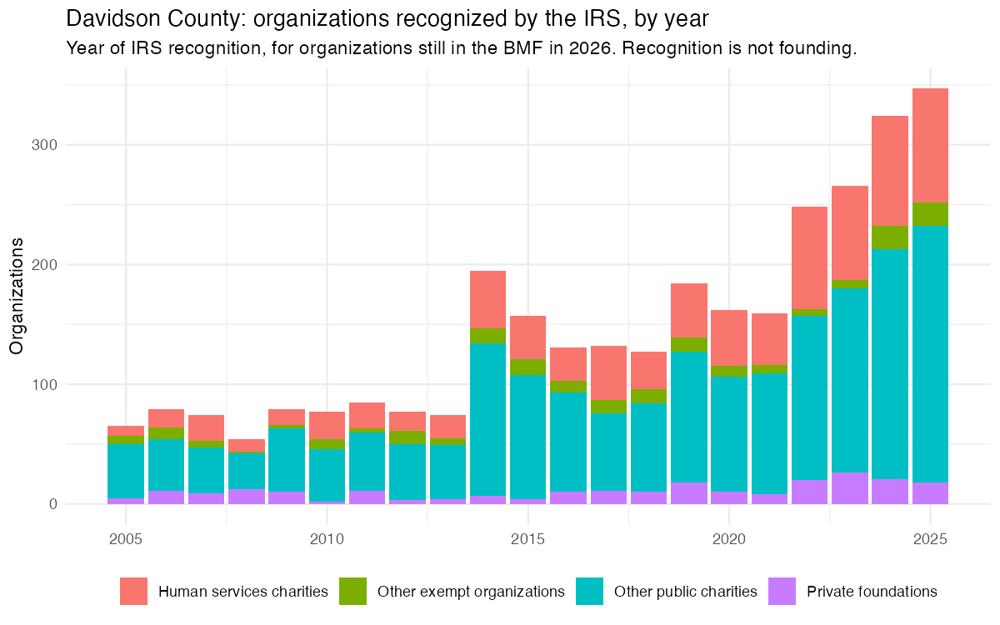
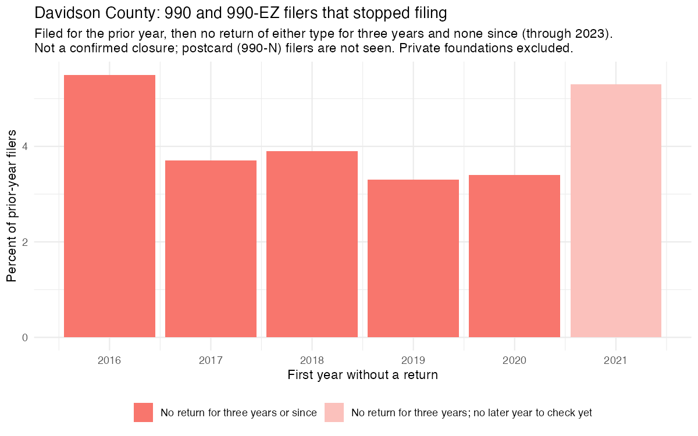
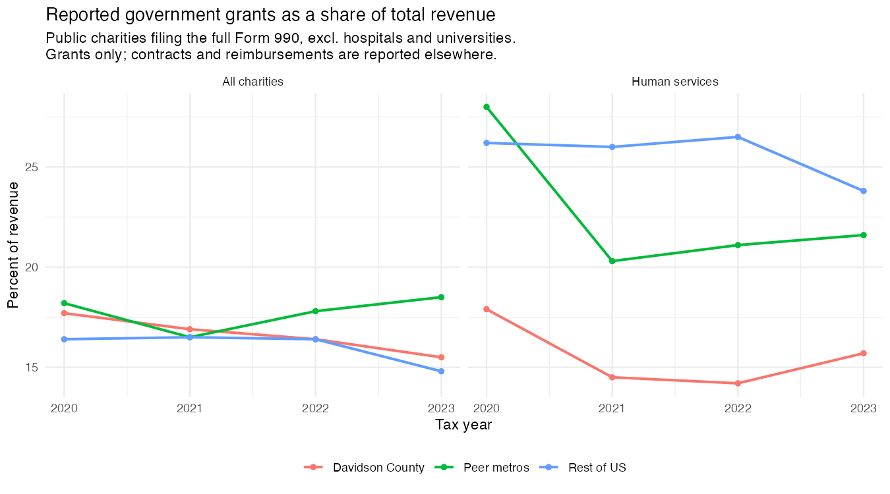
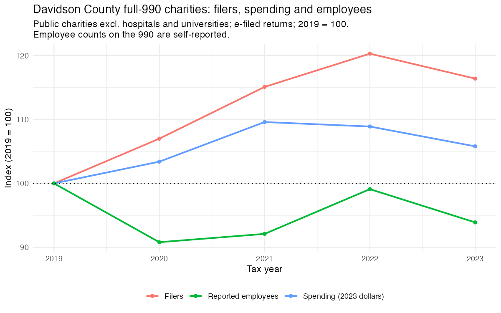

## Summary

This profile describes the nonprofit and philanthropic sector in Davidson County (Metro Nashville) using the returns that organizations file with the IRS. It accompanies the spreadsheet of organizations on the Ecosystem Map. The latest complete year of returns is 2023.

- **Most organizations are small.** Of the Davidson charities large enough to file a financial return, half spend under $332,000 a year and seven in ten spend under $1 million.
- **Only about one charity in five files a full return.** Davidson has 4,046 public charities outside hospitals and universities. For 2023, 872 filed the full Form 990, the only form that reports employees and government grants.
- **Thirteen hospitals and universities account for most of the dollars.** They spent $10.7 billion of the $15.0 billion that all Davidson charities spent in 2023. This profile sets them aside so the figures describe the rest of the sector to prevent them from dominating the analysis.
- **More organizations are being recognized each year by the IRS.** IRS recognitions of nonprofit tax-exempt status in Davidsom ran at 130 to 200 a year from 2014 to 2021 and reached 347 in 2025.
- **Most organizations consistently filed tax returns.** Between 3 and 6 percent of filers stop each year, and that rate has been steady. So our sample is stable.
- **Human services charities in Davidson report less government grant money than their peers.** Grants were 15.7 percent of their revenue in 2023, against 21.6 percent in similar metros and 23.8 percent in the rest of the country.
- **Spending grew and reported employment held steady.** Among the same organizations in 2019 and 2023, spending rose 9 percent after inflation and reported employees were flat.
- **The organizations on the Ecosystem Map are older and larger than the typical Davidson charity.** Their median spending is $1.77 million a year, against $627,000.
- **Local funding is concentrated.** Of the 136 listed organizations registered in Davidson, 122 received a grant from a Davidson-based funder between 2019 and 2023. Ten funders supplied 67 percent of those dollars.

## About the data

**Where the figures come from.** Two IRS sources are used. The first is the Business Master File (BMF), the IRS list of every organization it recognizes as tax-exempt, with each one's address, type and year of recognition. This profile uses the September 2026 BMF. 

The second is the annual returns that organizations file, which include:

- The **full Form 990**, filed by larger organizations with gross receipts normally of $200,000 or more, or total assets of $500,000 or more. It reports spending, revenue, employees and government grants.
- The shorter **Form 990-EZ**, filed by smaller organizations with gross receipts less than $200,000 and total assets less than $500,000. It reports spending and revenue, but not employees or government grants.
- The **Form 990-PF**, filed by private foundations regardless of size. It reports spending and each grant paid.
- Organizations with receipts under $50,000 file only a postcard with no financial information. They are not represented in any financial figures here.

**Years.** A year in this profile is the IRS tax year, the year an organization's accounting period begins. The latest complete year is 2023. Returns reach the public later due to backdated filings and IRS data processing times.

**Place.** Davidson County and Metro Nashville are the same area. An organization is placed by its current address in the BMF. That is where it is based, which is not always where it works: an organization based in Davidson may also serve neighboring counties.

**Hospitals and universities.** They are left out of every financial and workforce figure unless a table says otherwise, for the reason given in the summary.

**Comparisons.** Davidson is compared with 19 metros of similar size (Memphis, Knoxville, Austin, Charlotte, Raleigh, Indianapolis, Louisville, Columbus, Kansas City, Jacksonville, Oklahoma City, Atlanta, Denver, St. Louis, Cincinnati, Richmond, Birmingham, San Antonio and Phoenix) and with the rest of the country.

**Dollars.** Spending comparisons over time are adjusted for inflation and shown in 2023 dollars. Grant amounts are shown as reported on the returns, without adjustment.

## How many organizations there are, and how many file

The BMF lists 5,146 tax-exempt organizations in Davidson County. Most do not file a return with financial information.

| Davidson County, in the 2026 BMF | Organizations | Filed a full 990 for 2023 | Filed a 990-EZ | Filed a 990-PF | No return seen |
|------------------------------|-----------------|---------------|------------|-----------|---------------|
| All organizations | 5,146 | 1,151 (22%) | 382 (7%) | 307 (6%) | 3,306 (64%) |
| Public charities | 4,067 | 885 (22%) | 311 (8%) | 2 | 2,869 (71%) |
| Public charities excl. hospitals and universities | 4,046 | 872 (22%) | 311 (8%) | 2 | 2,861 (71%) |
| Human services charities | 1,041 | 247 (24%) | 71 (7%) | 0 | 723 (69%) |

"No return seen" does not mean inactive. The group includes organizations small enough to file only the postcard, organizations that filed late, organizations that have closed operations, and organizations recognized after 2023 that had no 2023 return to file. Among public charities, 722 of the 2,869 (about one in four) were recognized after 2023. The data cannot separate the rest.

## Most organizations are small

The table shows total spending in 2023 for Davidson public charities outside hospitals and universities that filed a full 990 or a 990-EZ. The median is the middle organization: half spend less and half spend more.

| Organizations (2023) | Filers | One in four spends under | Median | One in four spends over | One in ten spends over | Share under $1 million |
|------------------------------|-------|---------|---------|---------|---------|---------|
| All charities, either form | 1,184 | $98,000 | $332,000 | $1.27M | $5.6M | 72% |
| Human services, either form | 319 | $103,000 | $347,000 | $1.20M | $5.9M | 73% |
| All charities, full 990 only | 875 | $262,000 | $632,000 | $2.26M | $7.9M | 62% |
| Human services, full 990 only | 248 | $247,000 | $509,000 | $1.85M | $8.0M | 65% |

Human services organizations are not larger than the rest of the nonprofits in our sample. The 309 organizations that file the shorter 990-EZ are about a quarter of these filers but hold 0.5 percent of the money: $24 million of $4.41 billion in spending. Their median spending is $67,000.

## New organizations

The IRS recognized 130 to 200 Davidson organizations a year from 2014 to 2021. The number then rose to 248 in 2022, 266 in 2023, 324 in 2024 and 347 in 2025. Human services charities followed the same path.

One caveat applies. Recognition is the year the IRS approved the organization, which can be later than the year it began work.

## Organizations that stop filing

The IRS does not record when an organization shuts down. This profile counts an organization as having stopped when it filed a 990 or 990-EZ for one year, filed neither for the next three years, and has not filed since. This follows published research (Harrison and Oxley 2025), which shows that shorter gaps overstate closures because many organizations skip a year or two and then file again.

However, the IRS does maintain a list of nonprofits that have had their tax-exempt status revoked, which is different from a nonprofit voluntarily winding down. By law, an organization that does not file its required annual return (or the postcard, for the smallest organizations) for three years in a row loses its tax-exempt status automatically. A revocation therefore means the organization fell three years behind on its filings. It does not show that the organization closed.

Eight of the 147 organizations on the Ecosystem Map that we matched to IRS records appear on the revocation list. Seven of them are tax-exempt again today:

- For five, the IRS restored the status back to the date it was revoked. To get this, an organization applies again and generally files the returns it missed. Once approved, its record shows no gap, as if the status had never lapsed.
- One was revoked in May 2016 and restored from May 2017, leaving a one-year gap in its record.
- One was revoked in May 2020, applied as a new organization, and was recognized again in March 2021.

One organization has not had its status restored. It was revoked in May 2010 and has no IRS record since.

| First year without a return | Filers the year before | Stopped filing |
|---|---|---|
| 2016 | 1,559 | 5.5% |
| 2017 | 1,555 | 3.7% |
| 2018 | 1,575 | 3.9% |
| 2019 | 1,608 | 3.3% |
| 2020 | 1,626 | 3.4% |
| 2021 | 1,614 | 5.3% (may fall as later returns arrive) |

Between 3 and 6 percent of Davidson filers stopped each year. These figures are an upper limit on closures, for two reasons. An organization that shrank below $50,000 and moved to the postcard looks the same as one that stopped. And an organization that stopped filing may have merged with another. Years after 2021 cannot be judged until more returns arrive.

## Government grants

The full 990 has one line for grants received from government. The table shows those grants as a share of total revenue, adding up all organizations in each group. The line covers grants only. Government contracts and fee-for-service payments, such as Medicaid, are reported elsewhere on the form mixed with other income, and cannot be separated.

| Government grants as a share of revenue | 2020 | 2021 | 2022 | 2023 |
|------------------------------|-------|-------|-------|-------|
| All charities, Davidson | 17.7% | 16.9% | 16.4% | 15.5% |
| All charities, similar metros | 18.2% | 16.5% | 17.8% | 18.5% |
| All charities, rest of US | 16.4% | 16.5% | 16.4% | 14.8% |
| Human services, Davidson | 17.9% | 14.5% | 14.2% | 15.7% |
| Human services, similar metros | 28.0% | 20.3% | 21.1% | 21.6% |
| Human services, rest of US | 26.2% | 26.0% | 26.5% | 23.8% |

Davidson's human services charities reported a smaller share than similar metros and the rest of the country in every year shown. Most organizations report no government grants at all: 53 percent of Davidson charities in 2020 and 66 percent in 2023. The series begins in 2020, so it cannot show when the gap opened, and the returns do not say how much of any year's grants was pandemic relief.

## Organizations, spending and employees, 2019 to 2023

These figures cover Davidson public charities outside hospitals and universities that filed the full 990. Employee counts are the number each organization reports on its return.

| | 2019 | 2023 | Change, all filers | Change, same organizations in both years |
|--------------------|----------|----------|----------|--------------|
| Organizations filing | 757 | 881 | +16% | 625 filed in both years |
| Spending, 2023 dollars | $4.15 billion | $4.39 billion | +6% | +9% |
| Reported employees | 47,861 | 44,948 | -6% | -0.6% |

Reported employees fell 6 percent across all filers, but that is mostly a change in which organizations filed, not a change inside organizations. Among the 625 organizations that filed in both years, employees were flat and spending rose 9 percent after inflation.

## The organizations on the Ecosystem Map

The Ecosystem Map lists 159 organizations. We matched 147 of them to IRS records by name and address. Four were removed for being out of scope, and eight could not be matched because they are companies, church-run bodies, or have no IRS record under the listed name.

Of the matched organizations, 136 are registered in Davidson County. The comparison below uses the 123 of them that are public charities outside hospitals and universities. The other 13 are private foundations (7), other types of exempt organization (3), hospitals or universities (2), and one charity no longer in the BMF.

| Measure | Listed organizations | All Davidson public charities excl. hospitals and universities |
|--------------------------|--------------|--------------------|
| Organizations | 123 | 4,046 |
| Median age (years since IRS recognition) | 23 | 11 |
| Recognized in 2020 or later | 14% | 36% |
| Filed a full 990 for 2023 | 96 | 872 |
| Median spending (full 990 filers) | $1.77M | $627,000 |
| Median reported employees (full 990 filers) | 20 | 4 |
| Reporting any government grants (full 990 filers) | 62% | 35% |
| Government grants as a share of revenue (full 990 filers) | 17.2% | 15.6% |

The listed organizations are older, larger, more often staffed, and more often government funded than Davidson charities as a whole. The list was chosen by the project team, so this describes the list and not the sector.

## Who funds whom, 2019 to 2023

Funders report the grants they make on their own returns. Public charities that make grants list each recipient that received more than $5,000. Private foundations list every grant. This section uses the grants reported by funders based in Davidson County to the 136 listed organizations registered in Davidson. Grants to individuals are left out.

| Year | Grants | Funders | Listed organizations reached | Total ($ million) |
|---|---|---|---|---|
| 2019 | 1,539 | 130 | 96 | 34.6 |
| 2020 | 2,312 | 170 | 103 | 60.3 |
| 2021 | 1,170 | 172 | 103 | 47.8 |
| 2022 | 1,124 | 170 | 104 | 56.7 |
| 2023 | 1,074 | 167 | 118 | 63.4 |

Over the five years, 122 of the 136 listed organizations received at least one grant from one of 247 Davidson-based funders. Among those that received a grant, the median organization had nine Davidson funders. The funding is concentrated: the largest funder supplied 25 percent of the dollars, the top three 46 percent, and the top ten 67 percent. The high total in 2020 comes from one funder's COVID-19 relief grants.

Twenty-four of the funders are themselves on the Ecosystem Map. Grants from one listed organization to another grew from $21 million in 2019 to $42 million in 2023. Where a listed organization passes money on to another, the same dollar is counted twice.

Three cautions for reading this section:

- Funders based outside Davidson County are not included. An organization with no grant shown here is not necessarily unfunded.
- Two organizations sharing a funder is not evidence of duplication, and an organization with no matched grant is not evidence of a gap.
- Foundation returns give each recipient's name and city but no identifying number. Those grants were matched by name and checked by hand.

## The companion spreadsheet

The spreadsheet lists each organization on the Ecosystem Map with the following, where a return is available:

- **Operating expenses** for 2023, with the form the figure came from. Expenses are a better indicator of size and capacity, since they reflect the resources deployed by the nonprofits towards their missions. Where an organization has no 2023 return, its 2022 figure is used and marked. Fourteen organizations carry a 2022 figure.
- **A size category**: Using operating expenses, we divide the nonprofits in the ecosystem map into the following size bands:
    - Small is under $1 million
    - Medium is $1 million to under $10 million
    - Large is $10 million and over
- Nonprofits are sized by total spending. Philanthropic organizations are sized by their grants to Davidson County recipients. Of the 134 organizations with a figure, 50 are Small, 56 are Medium and 28 are Large. Twenty-five have no figure.
- **Grants paid**, for the 35 listed organizations that itemize grants on their returns: the total to all recipients, and the part paid to recipients based in Davidson County. For example, the Community Foundation of Middle Tennessee itemized $59.7 million in grants, of which $27.1 million (45 percent) went to Davidson recipients. United Way of Middle Tennessee itemized $26.9 million, of which $18.8 million (70 percent) went to Davidson recipients.

A recipient is counted as a Davidson recipient by where it is based, not by where its work reaches.

The Boedecker Foundation is registered in Colorado, so its spending figure covers the whole foundation. Its own list of grants shows how much went to Nashville:

| Tax year | Grants paid | Share to the Nashville metro | Share to Davidson County |
|---|---|---|---|
| 2020 | $2.42M | 27% | 26% |
| 2021 | $1.58M | 43% | 41% |
| 2022 | $1.68M | 55% | 53% |
| 2023 | $1.50M | 66% | 65% |
| 2024 | $1.46M | 51% | 48% |

The 2023 Davidson figure, $978,000 across 25 grants, is the one on the spreadsheet.

## What the data cannot tell us

- **Nothing after 2023.** Returns arrive two to three years late. This profile cannot describe current conditions.
- **Very small organizations.** Organizations under $50,000 in receipts file no financial information. They are counted in the BMF and nowhere else.
- **Closures.** The IRS does not record them. Stopping filing may mean closing, merging, or shrinking.
- **Government contracts.** Only government grants are reported separately. Contract and fee income from government cannot be measured.
- **Where services are delivered.** Organizations are placed by their address, not by the area they serve.
- **Funders outside Davidson County.** The funding section covers Davidson-based funders only.
- **Employee counts.** They are reported by each organization and are not checked by the IRS.

## Sources and methods

- **IRS Business Master File**, September 2026, as published by the National Center for Charitable Statistics (NCCS) at the Urban Institute.
- **IRS Form 990, 990-EZ and 990-PF returns**, tax years 2015 to 2023, from the public e-filed returns and from the NCCS CORE files, which are built from IRS extracts of the same returns.
- **Hospitals and universities** are identified by the classification code the BMF carries for each organization.
- **Stopped filing** follows the rule in Harrison, T. D., and Oxley, J. (2025), "Nonprofit Entry, Exit, and Implications for Sector Growth," *Nonprofit Management and Leadership* 36: 57-69.
- **Tax year.** Where a return's stated tax year is available it is used. Otherwise it is worked out from the month the accounting period ends, which is exact for 12-month years and approximate for the few returns that cover a shorter period.
- **Inflation adjustment** uses the Consumer Price Index.
- The analysis was reviewed by a senior researcher before release.
