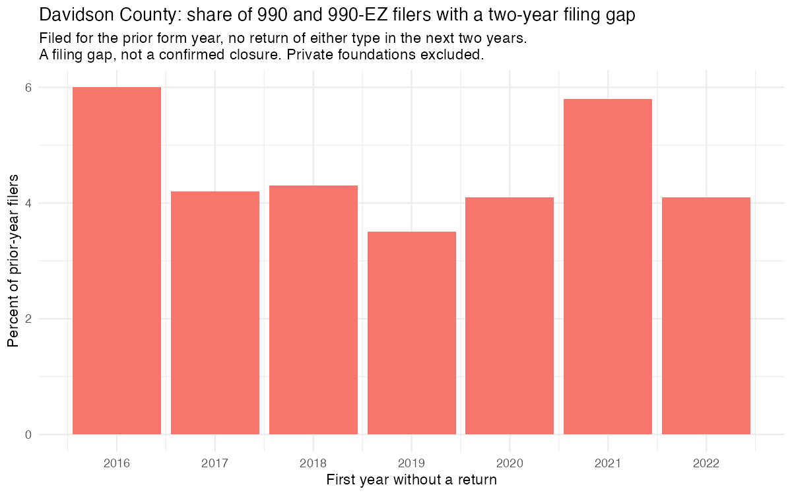
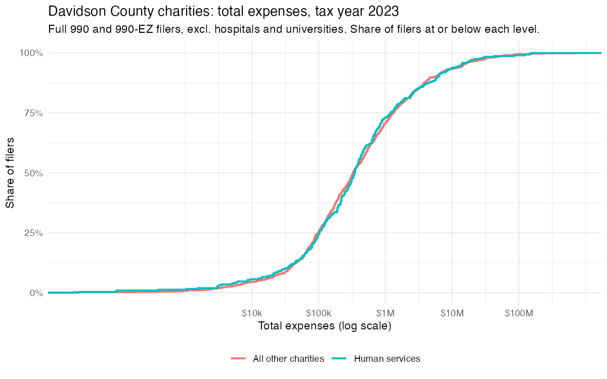
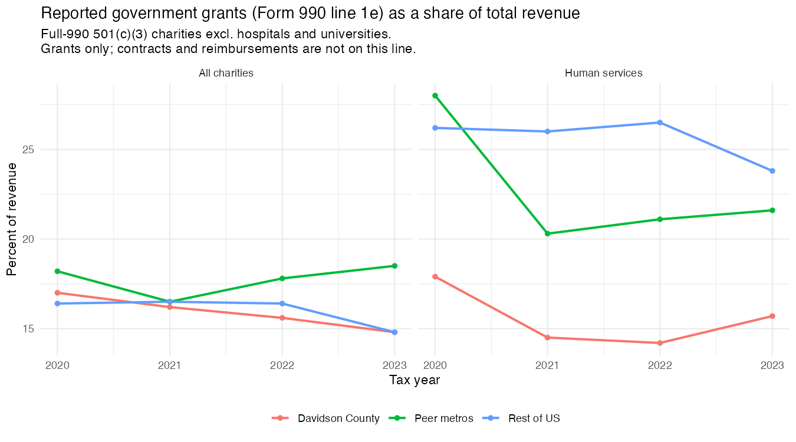
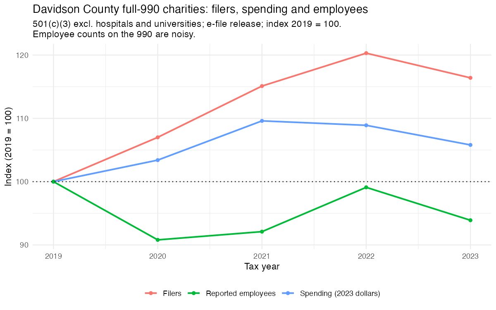
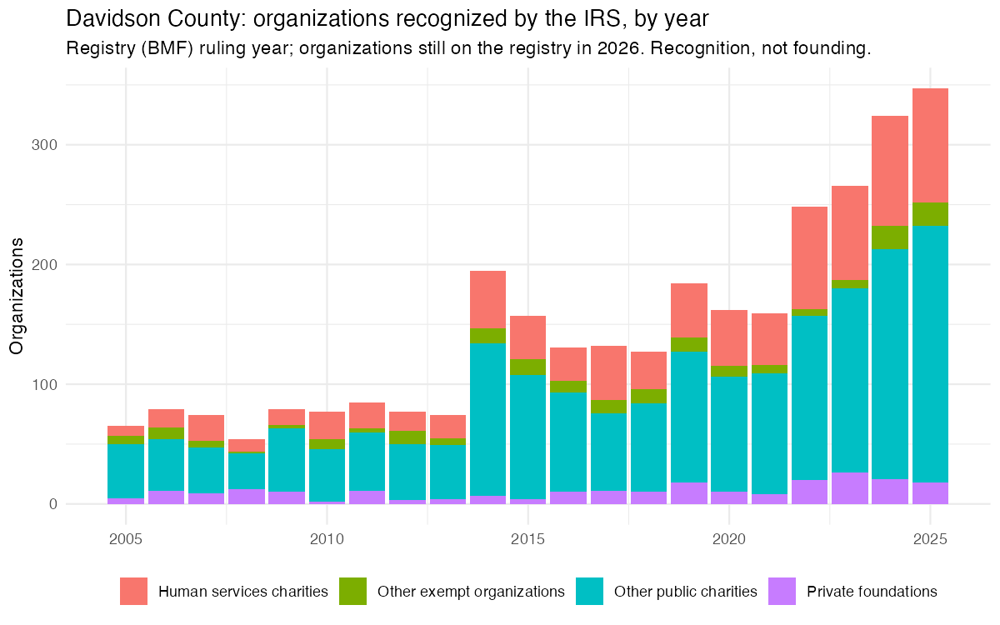

## The ask

The Research to Action Lab, working with Metro Nashville and the Community Foundation of Middle Tennessee, asked what the IRS data show about nonprofit locations, finances and workforce in Nashville, as a companion to a recent survey of the Tennessee nonprofit workforce. The first memo (October 12) was a first look. This draft answers the follow-up: a health profile of the Davidson County (Metro Nashville) nonprofit and philanthropic sector, and a spreadsheet of 2023 operating expenses for the 141 organizations on the team's Ecosystem Map. The spreadsheet has gone to the team; this draft covers the profile.

## Corrections since the first memo

Three things in the first memo have changed.

**Exits.** The first memo said that nearly half of the organizations that appeared to stop filing a full 990 after 2019 had in fact filed for 2023 and were missing from the e-file release. The two sources date returns differently, and I had read a set of fiscal-year 2022 returns as 2023 returns. Dated the same way, no organization is in one source and missing from the other. Of the 128 metro organizations that stopped filing a full 990, 76 last filed for 2022, 17 for 2021, 13 moved to the shorter 990-EZ, and 22 have no return since 2020. The pay gap between those that stopped and those that stayed is about $9,600 per employee, on 102 organizations, not $17,200 on 42. The peer metros show no gap.

**Coverage.** The first memo said the two sources of 990 returns each miss 5 to 6 percent of the other's 2023 filings. Dated the same way, the e-file returns hold everything the IRS statistical extract holds for Davidson, plus 234 filings the extract has not yet released.

**Hospitals and universities.** Two Davidson universities carry no classification code on the registry and were inside the charity totals. They are now excluded with the rest. The all-charity government grant share for 2023 is 15.5 percent, not 14.8.

## Sources

Three sources, each named in every table.

- **The IRS registry** (Business Master File): every organization currently recognized, with its address, type and year of recognition. Current to 2026.
- **The 990 returns as e-filed**: the full Form 990, the shorter 990-EZ, and the 990-PF that private foundations file. Finances and workforce come from the full 990; the 990-EZ carries total expenses but no employee count or government grant line; the 990-PF carries expenses and grants paid. Returns end at tax year 2023.
- **The IRS statistical extract** of the same returns, used to check what the e-file release holds and to find organizations that moved to the shorter form.

Tax year means the IRS form year, the year the accounting period begins. Dollar figures are in 2023 dollars. Nashville is compared with 19 other metros of similar size (Memphis, Knoxville, Austin, Charlotte, Raleigh, Indianapolis, Louisville, Columbus, Kansas City, Jacksonville, Oklahoma City, Atlanta, Denver, St. Louis, Cincinnati, Richmond, Birmingham, San Antonio, Phoenix), our choice, and with the rest of the country. Hospitals and universities are excluded from every financial and workforce figure unless a table says otherwise.

## Your five points

### Who is actually observed

The registry lists every organization recognized; most file no return with financial information. For 2023:

| Davidson County, on the 2026 registry | Registered | Full 990 | 990-EZ | 990-PF | No return seen |
|---|---|---|---|---|---|
| All registered organizations | 5,146 | 1,151 (22%) | 382 (7%) | 307 (6%) | 3,306 (64%) |
| 501(c)(3) public charities | 4,067 | 885 (22%) | 311 (8%) | 2 | 2,869 (71%) |
| Public charities excl. hospitals and universities | 4,046 | 872 (22%) | 311 (8%) | 2 | 2,861 (71%) |
| Human services charities | 1,041 | 247 (24%) | 71 (7%) | 0 | 723 (69%) |

"No return seen" covers organizations under $50,000 in receipts, which file only a postcard, late filers, and organizations that have stopped; the sources do not separate them. About one charity in five files a full 990, and those are the population for every financial and workforce figure below. "Recognized" in this draft always means on the registry; "filed" always means a return.

### Hospitals and universities

They are identified by the registry's classification code (NTEE-V2 subsectors HOS and UNI), with two universities added by hand because their code is blank. Thirteen institutions in Davidson filed a full 990 for 2023 and spent $10.7 billion of the $15.0 billion that all Davidson charities spent. Including them turns every aggregate into a statement about those thirteen, which is why they are excluded. The coverage table above shows the sector with and without them.

### Exits

The registry does not record when an organization leaves, so two series are kept apart and never added together.

**Stopped filing.** Of the Davidson organizations that filed a 990 or 990-EZ in a given year, the share with no return of either type in the next two years ran between 3.5 and 6 percent a year from 2016 to 2022. This is a two-year filing gap, not a confirmed closure; some file again later. The figure for 2023 cannot be judged yet because the statistical extract's 2024 file is incomplete.

**Left the registry.** The first year an organization present on the registry by 2018 is absent from it. This series moves in steps (236 charities in 2017, 116 in 2021, 83 in 2023) because the registry is updated in batches and reflects revocation lists as much as closures.

When an organization stops appearing in the full 990 returns, that does not mean it closed. It may have merged, shrunk enough to file the shorter form, filed late, or filed a return the IRS has not released yet. Whether the ones with no return closed or merged is not known.

### Location

Location is the address on the organization's return, applied to every year of its history. An organization based in Davidson may serve Williamson, and the large regional organizations are all based in Davidson. The metro figures therefore lead in this draft, and county comparisons are shown second and read as where organizations are based, not where they serve.

### The workforce measures

Employee counts on the 990 are a self-reported number and noisy. "Pay per employee" means salaries, benefits and payroll taxes (Part IX lines 5 to 10) divided by the reported employee count. "Spending more than they took in" means total expenses exceeded total revenue (Part I line 18 greater than line 12). The workforce table below shows the change two ways, across all filers and across the same organizations in both years.

## Findings

### How small most organizations are

Total expenses in 2023, Davidson public charities excluding hospitals and universities, full 990 and 990-EZ filers together. Organizations under $50,000 in receipts are not in any row.

| Population (2023) | Filers | 25th pct | Median | 75th pct | 90th pct | Under $1M |
|---|---|---|---|---|---|---|
| All charities, full 990 and 990-EZ | 1,184 | $99k | $332k | $1.27M | $5.6M | 72% |
| Human services, full 990 and 990-EZ | 319 | $103k | $347k | $1.20M | $5.9M | 73% |
| All charities, full 990 only | 875 | $262k | $632k | $2.26M | $7.9M | 62% |
| Human services, full 990 only | 248 | $247k | $509k | $1.85M | $8.0M | 65% |

Half of the organizations large enough to file either form spend under $332,000 a year, and seven in ten under $1 million. Human services organizations are no larger than the rest.

### Government grants, 2020 to 2023

Government grants as reported on the full 990 (Part VIII line 1e) as a share of total revenue, dollar-weighted. This line is grants only; contracts and reimbursements are reported elsewhere and cannot be separated. About two thirds of filers report nothing on the line, so the median organization's share is zero in every year.

| Share of revenue in reported government grants | 2020 | 2021 | 2022 | 2023 |
|---|---|---|---|---|
| All charities, Davidson | 17.7% | 16.9% | 16.4% | 15.5% |
| All charities, peer metros | 18.2% | 16.5% | 17.8% | 18.5% |
| All charities, rest of US | 16.4% | 16.5% | 16.4% | 14.8% |
| Human services, Davidson | 17.9% | 14.5% | 14.2% | 15.7% |
| Human services, peer metros | 28.0% | 20.3% | 21.1% | 21.6% |
| Human services, rest of US | 26.2% | 26.0% | 26.5% | 23.8% |

Davidson's human services charities reported a smaller share than the peer metros and the rest of the country in every year shown. The series starts in 2020, so it cannot say when the gap began, and the 990 cannot say how much of any year's figure was pandemic relief.

### Filers, spending and employees, 2019 to 2023

Full-990 public charities excluding hospitals and universities, Davidson County.

| | 2019 | 2023 | Change, all filers | Change, same 625 organizations in both years |
|---|---|---|---|---|
| Filers | 757 | 881 | +16% | |
| Spending, 2023 dollars | $4.15bn | $4.39bn | +6% | +9% |
| Reported employees | 47,861 | 44,948 | -6% | -0.6% |

Among the organizations present in both years, employees were flat and real spending rose 9 percent. About nine tenths of the 6 percent decline across all filers comes from organizations leaving or joining the filer population. Through 2022 the same comparison gives -2.8 percent and +4.5 percent.

### Recognitions by year

Davidson recognitions ran at 130 to 200 a year from 2014 to 2021, then rose to 248 in 2022, 266 in 2023, 324 in 2024 and 347 in 2025 among organizations still on the registry. Human services charities followed the same path. Part of the recent rise is survival: older cohorts have had time to lapse.

### The listed organizations

The team's list names 141 organizations; 131 were matched to the registry by hand, and the 10 unmatched are companies, church-run bodies and organizations with no registry record under their names. Against all Davidson public charities, the listed organizations are older, larger, more often staffed, and more often government funded. The list is the team's selection, so this describes the list, not the sector.

| Measure | Listed, registered in Davidson | All Davidson public charities excl. hospitals and universities |
|---|---|---|
| Organizations on the registry | 105 | 4,046 |
| Median age (years since recognition) | 23 | 11 |
| Recognized 2020 or later | 12% | 36% |
| Full-990 filers, 2023 | 81 | 872 |
| Median total expenses (full 990) | $1.78M | $627k |
| Median reported employees (full 990) | 20 | 4 |
| Reporting any government grants (full 990) | 60% | 35% |
| Government grant share of revenue (full 990) | 17.0% | 15.6% |

### Who funded whom, 2019 to 2023

Grants reported by Davidson-based funders on their own returns: the full 990's grants schedule (recipients over $5,000 in aggregate, with the recipient's EIN) and the 990-PF's list of grants paid (name and city only, matched by name and checked by hand). Recipients are the 116 listed organizations registered in Davidson. Grants to individuals are excluded. Funders based outside Davidson are not in the data, so an organization with no matched grant is not unfunded.

| Year | Grants | Funders | Listed recipients reached | Total ($M) |
|---|---|---|---|---|
| 2019 | 1,379 | 120 | 82 | 30.9 |
| 2020 | 2,116 | 159 | 89 | 56.1 |
| 2021 | 1,041 | 159 | 89 | 43.7 |
| 2022 | 978 | 154 | 88 | 52.7 |
| 2023 | 951 | 154 | 101 | 58.6 |

Over the five years, 104 of the 116 listed organizations received at least one grant from one of 234 Davidson-based funders. The median listed organization had 10 Davidson funders. The largest funder supplied 25 percent of the dollars, the top three 47 percent and the top ten 70 percent. Twenty-one funders are themselves on the list, and grants between listed organizations ran from $20 million in 2019 to $38 million in 2023; where a listed intermediary passes money on, the same dollar can appear twice. A shared funder is a shared funder, not duplication, and no matched grant is not a gap. The 2020 spike is one funder's itemized COVID-19 relief grants.

## Three questions for you

1. **Exits.** Is the two-year filing gap acceptable as the main series, with the registry series as a check and 2023 withheld?
2. **Comparator for the list.** All Davidson public charities is the headline. Is a second comparison against full-990 filers of similar size worth the space?
3. **990-EZ filers.** They are in the expense distribution and the spreadsheet with the form named, and out of the employee and grant measures, which the EZ does not carry. Agreed?
