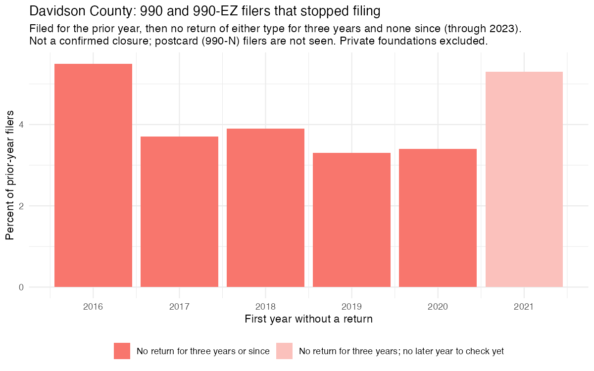
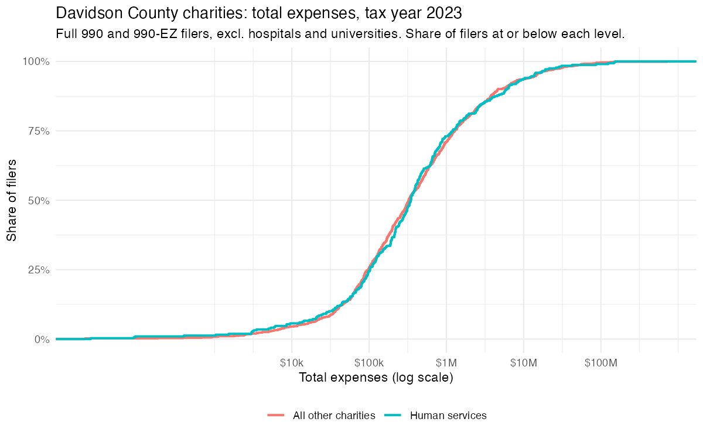
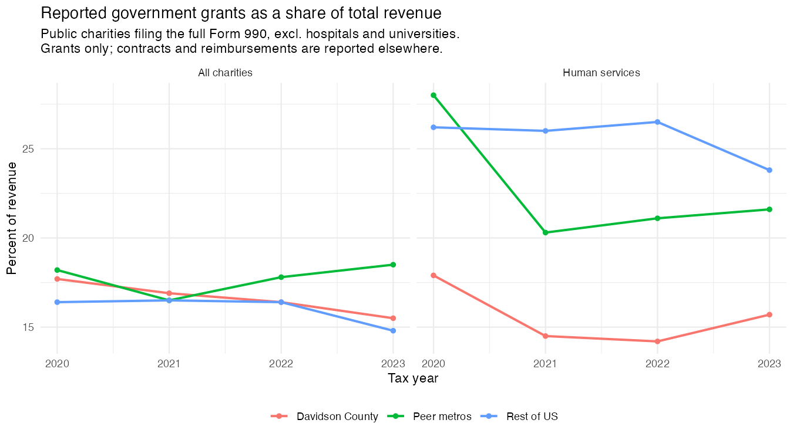
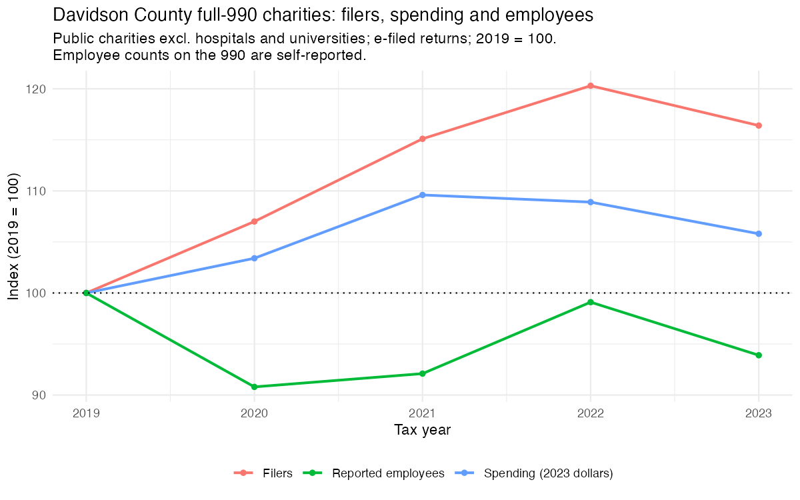
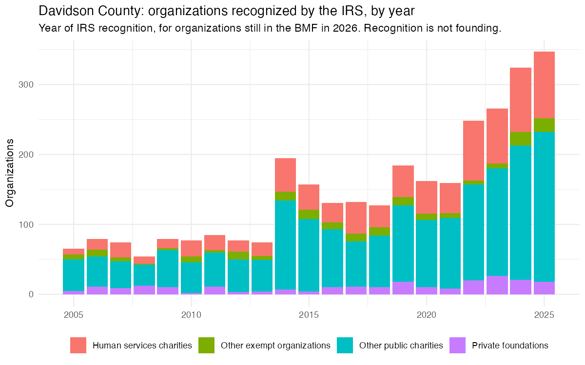

## Task

The Research to Action Lab, working with Metro Nashville and the Community Foundation of Middle Tennessee, asked what the IRS data show about nonprofit locations, finances and workforce in Nashville, as a companion to a recent survey of the Tennessee nonprofit workforce. The first memo (October 12) was a first look. This draft answers the follow-up: a health profile of the Davidson County (Metro Nashville) nonprofit and philanthropic sector, and a spreadsheet of 2023 operating expenses for the 141 organizations on the team's Ecosystem Map. The spreadsheet has gone to the team; this draft covers the profile.

## Corrections since the first memo

Three things in the first memo have changed.

**Exits.** The first memo said that nearly half of the organizations that appeared to stop filing a full 990 after 2019 had in fact filed for 2023 and were missing from the e-file release. The two sources label years differently by design. The e-file returns carry the IRS tax year, the year the accounting period begins. CORE labels a return by the calendar year the period ends. An organization's July 2022 to June 2023 return is therefore a 2022 return in the e-file data and a 2023 return in CORE. I did not convert between the two: the 58 organizations I counted as having filed for 2023 were fiscal-year filers whose 2022 return carried CORE's 2023 label, and none had filed for 2023 in either source. Converted, no organization is in one source and missing from the other. Of the 128 metro organizations that stopped filing a full 990, 76 last filed for 2022, 17 for 2021, 13 moved to the shorter 990-EZ, and 22 have no return since 2020. The pay gap between those that stopped and those that stayed is about $9,600 per employee, on 102 organizations, not $17,200 on 42. The peer metros show no gap.

**Coverage.** The first memo said the two sources of 990 returns each miss 5 to 6 percent of the other's 2023 filings. Converted to the same year, the e-file returns hold everything CORE holds for Davidson, plus 231 filings that CORE has not yet released.

**Hospitals and universities.** Two Davidson universities carry no classification code in the BMF and were inside the charity totals. They are now excluded with the rest. The all-charity government grant share for 2023 is 15.5 percent, not 14.8.

## Sources

Three sources, each named in every table.

- **The BMF** (the IRS Business Master File): every organization currently recognized, with its address, type and year of recognition. The September 2026 BMF is used.
- **The 990 returns as e-filed**: the full Form 990, the shorter 990-EZ, and the 990-PF that private foundations file. Finances and workforce come from the full 990; the 990-EZ carries total expenses but no employee count or government grant line; the 990-PF carries expenses and grants paid. Returns end at tax year 2023.
- **CORE** (the NCCS CORE files, built from the IRS statistical extracts of the same returns), used to check what the e-file release holds and to find organizations that moved to the shorter form. CORE labels a return by the calendar year its accounting period ends. This draft converts to the IRS tax year: where the same return is in the e-file data, the tax year stated on the return is used; otherwise the year is worked out from the month the period ends, which is exact for 12-month years and approximate for the few returns covering a shorter period.

Tax year means the IRS form year, the year the accounting period begins. Workforce spending comparisons are in 2023 dollars. Grant amounts are nominal amounts reported on the returns. Nashville is compared with 19 other metros of similar size (Memphis, Knoxville, Austin, Charlotte, Raleigh, Indianapolis, Louisville, Columbus, Kansas City, Jacksonville, Oklahoma City, Atlanta, Denver, St. Louis, Cincinnati, Richmond, Birmingham, San Antonio, Phoenix), our choice, and with the rest of the country. Hospitals and universities are excluded from every financial and workforce figure unless a table says otherwise.

## Your five points

### Who is actually observed

The BMF lists every organization recognized; most file no return with financial information. For 2023:

| Davidson County, in the 2026 BMF | Registered | Full 990 | 990-EZ | 990-PF | No return seen |
|------------------------------|-----------------|---------------|------------|-----------|---------------|
| All registered organizations | 5,146 | 1,151 (22%) | 382 (7%) | 307 (6%) | 3,306 (64%) |
| 501(c)(3) public charities | 4,067 | 885 (22%) | 311 (8%) | 2 | 2,869 (71%) |
| Public charities excl. hospitals and universities | 4,046 | 872 (22%) | 311 (8%) | 2 | 2,861 (71%) |
| Human services charities | 1,041 | 247 (24%) | 71 (7%) | 0 | 723 (69%) |

"No return seen" covers organizations under $50,000 in receipts, which file only a postcard, late filers, and organizations that have stopped; the sources do not separate them. The group also holds organizations recognized after 2023, which could not have been expected to file for that year: 806 of the 3,306 across all organizations, and 722 of the 2,869 public charities (about one in four). Recognition is not founding, so some of these existed earlier. The table is therefore the 2026 BMF set against 2023 returns, and the 71 percent is not a rate of non-filing or inactivity. About one charity in five files a full 990. Each table below says which filers it counts. "Recognized" in this draft always means listed in the BMF; "filed" always means a return.

### Hospitals and universities

They are identified by the BMF's classification code (NTEE-V2 subsectors HOS and UNI), with two universities added by hand because their code is blank. Thirteen institutions in Davidson filed a full 990 for 2023 and spent $10.7 billion of the $15.0 billion that all Davidson charities spent. Including them turns every aggregate into a statement about those thirteen, which is why they are excluded. The coverage table above shows the sector with and without them.

### Exits

The BMF does not record when an organization leaves, so two series are kept apart and never added together.

**Stopped filing.** An organization is counted as stopped when it filed a 990 or 990-EZ for one year, filed neither for the next three years, and has not filed since. This is the rule in Harrison and Oxley (2025, Nonprofit Management and Leadership), who show that shorter gaps overstate exits because many organizations skip years and file again. On this rule, between 3.3 and 5.5 percent of Davidson filers stopped each year from 2016 to 2021.

| First year without a return | Filers the year before | No return for two years | No return for three years | Stopped: three years and none since |
|---|---|---|---|---|
| 2016 | 1,559 | 6.0% | 5.8% | 5.5% |
| 2017 | 1,555 | 4.2% | 4.1% | 3.7% |
| 2018 | 1,575 | 4.3% | 4.0% | 3.9% |
| 2019 | 1,608 | 3.5% | 3.4% | 3.3% |
| 2020 | 1,626 | 4.1% | 3.7% | 3.4% |
| 2021 | 1,614 | 5.8% | 5.3% | 5.3% (no later year to check yet) |

The shorter gap does overstate. Of the 441 organizations with a two-year gap in the table, 43 (10 percent) had filed again by 2023.

Three limits apply. First, the returns end at 2023, so the 2021 figure has no later year to check and can only fall, and nothing after 2021 can be judged yet. Second, the postcard return (990-N) is not in the data, so an organization that fell under $50,000 in receipts looks the same as one that stopped. Harrison and Oxley find national exit rates of 2 to 5 percent a year without postcard filers and 1 to 3 percent with them, so the Davidson figures are an upper bound. Third, stopping is not closing: the organization may have merged or shrunk.

**Left the BMF.** For each year, we take every Davidson organization in the BMF the year before and count the share that is absent from that year on. It ran at 3 to 6 percent a year, with two spikes (7.9 percent in 2017, 5.9 percent in 2021) and two years with no exits at all (2018, 2022), because the BMF is updated in batches and reflects revocation lists as much as closures.

When an organization stops appearing in the full 990 returns, that does not mean it closed. It may have merged, shrunk enough to file the shorter form, filed late, or filed a return the IRS has not released yet. Whether the ones with no return closed or merged is not known.

### Location

Location is the organization's address in the BMF, placed in a county and metro through the published geography files and applied to every year of its history. It is the current address, not where the organization was in earlier years and not where it serves: an organization based in Davidson may serve Williamson. County comparisons are read as where organizations are based.

### The workforce measures

Employee counts on the 990 are a self-reported number and noisy. "Pay per employee" means salaries, benefits and payroll taxes (Part IX lines 5 to 10) divided by the reported employee count. "Spending more than they took in" means total expenses exceeded total revenue (Part I line 18 greater than line 12). The workforce table below shows the change two ways, across all filers and across the same organizations in both years.

## Findings

### How small most organizations are

Total expenses in 2023, Davidson public charities excluding hospitals and universities, full 990 and 990-EZ filers together. Organizations under $50,000 in receipts are not in any row. The counts differ slightly from the coverage table because this table takes every 2023 filer, including 11 no longer in the BMF (7 full 990, 4 990-EZ), and leaves out 10 that reported no expenses (4 full 990, 6 990-EZ): 872 becomes 875 full-990 filers and 311 becomes 309 990-EZ filers.

| Population (2023) | Filers | 25th pct | Median | 75th pct | 90th pct | Under $1M |
|----------------------------------|---------|----------|------------|------------|-----------|------------|
| All charities, full 990 and 990-EZ | 1,184 | $98k | $332k | $1.27M | $5.6M | 72% |
| Human services, full 990 and 990-EZ | 319 | $103k | $347k | $1.20M | $5.9M | 73% |
| All charities, full 990 only | 875 | $262k | $632k | $2.26M | $7.9M | 62% |
| Human services, full 990 only | 248 | $247k | $509k | $1.85M | $8.0M | 65% |

Half of the organizations large enough to file either form spend under $332,000 a year, and seven in ten under $1 million. Human services organizations are no larger than the rest. The 309 organizations on the 990-EZ are 26 percent of these filers and 0.5 percent of the money: $24 million of $4.41 billion in expenses, and the same share of revenue. Their median is $67,000, against $632,000 for full-990 filers.

### Government grants, 2020 to 2023

Government grants as reported on the full 990 (Part VIII line 1e) as a share of total revenue, dollar-weighted. This line is grants only; contracts and reimbursements are reported elsewhere and cannot be separated. Many filers report nothing on the line: 53 percent of Davidson charities in 2020, rising to 66 percent in 2023. The median organization's share is therefore zero in every group and year shown except Davidson human services in 2020, where exactly half reported a grant and the median was 0.25 percent.

| Share of revenue in reported government grants | 2020 | 2021 | 2022 | 2023 |
|---|---|---|---|---|
| All charities, Davidson | 17.7% | 16.9% | 16.4% | 15.5% |
| All charities, peer metros | 18.2% | 16.5% | 17.8% | 18.5% |
| All charities, rest of US | 16.4% | 16.5% | 16.4% | 14.8% |
| Human services, Davidson | 17.9% | 14.5% | 14.2% | 15.7% |
| Human services, peer metros | 28.0% | 20.3% | 21.1% | 21.6% |
| Human services, rest of US | 26.2% | 26.0% | 26.5% | 23.8% |

Davidson's human services charities reported a smaller share than the peer metros and the rest of the country in every year shown. The series starts in 2020, so it cannot say when the gap began, and the 990 cannot say how much of any year's figure was pandemic relief.

### Filers, spending and employees, 2019 to 2023

Full-990 public charities excluding hospitals and universities, Davidson County, from the e-file returns alone. The 881 filers in 2023 include organizations no longer in the BMF and those reporting no expenses, which is why the count is above the 872 and 875 in the earlier tables.

| | 2019 | 2023 | Change, all filers | Same organizations in both years |
|---|---|---|---|---|
| Filers | 757 | 881 | +16% | 625 in both years |
| Spending, 2023 dollars | $4.15bn | $4.39bn | +6% | +9% |
| Reported employees | 47,861 | 44,948 | -6% | -0.6% |

Among the organizations present in both years, employees were flat and real spending rose 9 percent. About nine tenths of the 6 percent decline across all filers comes from organizations leaving or joining the filer population. Through 2022 the same comparison gives -2.8 percent and +4.5 percent.

### Recognitions by year

Davidson recognitions ran at 130 to 200 a year from 2014 to 2021, then rose to 248 in 2022, 266 in 2023, 324 in 2024 and 347 in 2025 among organizations still in the BMF. Human services charities followed the same path. Part of the recent rise is survival: older cohorts have had time to lapse.

### The listed organizations

The team's list names 159 organizations: 141 sent in October and 18 added on 3 November. After the team's answers on 3 November, 147 are matched to the BMF by hand, 4 were removed at the team's request (two national organizations whose figures would not be Nashville-only, one initiative of a national foundation, one membership body with no IRS record), and the 8 unmatched are companies, church-run bodies and organizations with no BMF record under their names. Against all Davidson public charities, the listed organizations are older, larger, more often staffed, and more often government funded. The list is the team's selection, so this describes the list, not the sector. Of the 136 listed organizations registered in Davidson, the comparison uses the 123 that are public charities in the 2026 BMF outside hospitals and universities; the other 13 are 7 private foundations, 3 exempt organizations of other types, 2 hospitals or universities, and 1 public charity no longer in the BMF. The funder section below uses all 136.

| Measure | Listed public charities registered in Davidson, excl. hospitals and universities | All Davidson public charities excl. hospitals and universities |
|------------|--------|--------|
| Organizations in the BMF | 123 | 4,046 |
| Median age (years since recognition) | 23 | 11 |
| Recognized 2020 or later | 14% | 36% |
| Full-990 filers, 2023 | 96 | 872 |
| Median total expenses (full 990) | $1.77M | $627k |
| Median reported employees (full 990) | 20 | 4 |
| Reporting any government grants (full 990) | 62% | 35% |
| Government grant share of revenue (full 990) | 17.2% | 15.6% |

### Who funded whom, 2019 to 2023

Grants reported by Davidson-based funders on their own returns: the full 990's grants schedule (recipients over $5,000 in aggregate, with the recipient's EIN) and the 990-PF's list of grants paid (name and city only, matched by name and checked by hand). Recipients are the 136 listed organizations registered in Davidson. Grants to individuals are excluded. Funders based outside Davidson are not in the data, so an organization with no matched grant is not unfunded.

| Year | Grants | Funders | Listed recipients reached | Total ($M) |
|---|---|---|---|---|
| 2019 | 1,539 | 130 | 96 | 34.6 |
| 2020 | 2,312 | 170 | 103 | 60.3 |
| 2021 | 1,170 | 172 | 103 | 47.8 |
| 2022 | 1,124 | 170 | 104 | 56.7 |
| 2023 | 1,074 | 167 | 118 | 63.4 |

Over the five years, 122 of the 136 listed organizations received at least one grant from one of 247 Davidson-based funders. Among those reached, the median organization had 9 Davidson funders. The largest funder supplied 25 percent of the dollars, the top three 46 percent and the top ten 67 percent. Twenty-four funders are themselves on the list, and grants between listed organizations ran from $21 million in 2019 to $42 million in 2023; where a listed intermediary passes money on, the same dollar can appear twice. A shared funder is a shared funder, not duplication, and no matched grant is not a gap. The 2020 spike is one funder's itemized COVID-19 relief grants.

### Grants that stay in Davidson County

The team asked that funders which give beyond Nashville show only their Davidson grants. A funder's operating expenses cannot be split by place, so the expense column stays as filed. Instead the sheet carries four further columns for every listed organization that itemizes grants on its return: grants paid to all recipients, the part paid to recipients based in Davidson County, the tax year of the return, and a check of the itemized total against the return's own grants-paid line. The year is 2023, or 2022 where the funder has no 2023 return in the releases at all (one organization); a funder that filed for 2023 but itemized no grants is not carried back. A recipient is placed in Davidson by its EIN on the BMF where the return gives one (the full 990's grants schedule), otherwise by its Tennessee ZIP code where the BMF knows that ZIP, otherwise by its city; this says where the recipient is based, not where its work reaches. Thirty-five listed organizations have the columns: all twelve listed private foundations with a 2023 990-PF in the e-file release, wherever registered, and the 23 Davidson-based full-990 filers with grants on Schedule I. Listed full-990 filers registered outside Davidson are not in that extract and are not covered; only one of them reports any grants (Legacy Mission Village, Williamson County, $53,000 on Part IX). Examples: the Community Foundation of Middle Tennessee paid $59.7 million in itemized grants, $27.1 million (45 percent) to Davidson recipients; United Way of Middle Tennessee $26.9 million, $18.8 million (70 percent). For two foundations the itemized list adds to more than the grants-paid line on the return (HCA Healthcare Foundation by $2.9 million, the Frist Foundation by $96,000), and one (Joe C. Davis, year ending September 2024) has no return in CORE yet to check against; the check column on the sheet says so for each.

The sheet also carries, at the team's request, a size band for every organization: Small under $1 million, Medium $1 million to under $10 million, Large $10 million and over, the three-way grouping of the NCCS Sector in Brief expense bands. A philanthropic organization is banded by its grants to Davidson County recipients, every other organization by its total expenses, and a column beside the band says which figure and which tax year it used. Where an organization has no tax year 2023 return in the source used for expenses, its tax year 2022 figure is used and flagged; fourteen organizations carry a 2022 expense figure, two of them private foundations whose 2023 grants list is nonetheless in the e-file release and feeds the grant columns. One of the fourteen has two different 2022 totals in CORE and the e-file release, and the note on the sheet gives both. Of the 134 organizations with a figure, 50 are Small, 56 Medium and 28 Large; 25 have no figure (removed, unmatched, church, newly recognized, or no return in the releases).

The Boedecker Foundation is registered in Colorado, so its expense figure is foundation-wide. From its own grants list:

| Tax year | Grants paid | To the Nashville metro | To Davidson County |
|---|---|---|---|
| 2020 | $2.42M | 27% | 26% |
| 2021 | $1.58M | 43% | 41% |
| 2022 | $1.68M | 55% | 53% |
| 2023 | $1.50M | 66% | 65% |
| 2024 | $1.46M | 51% | 48% |

The 2023 Davidson figure, $978,000 across 25 grants, is what the sheet shows. The yearly totals equal the grants-paid line on the foundation's own returns for 2020 to 2023; 2024 is not yet in CORE.

## Open question

**Comparator for the list.** All Davidson public charities is the headline comparison. Whether to add a second comparison against full-990 filers of similar size depends on whether the team is most interested in large organizations or the full range; that question is with the team.
